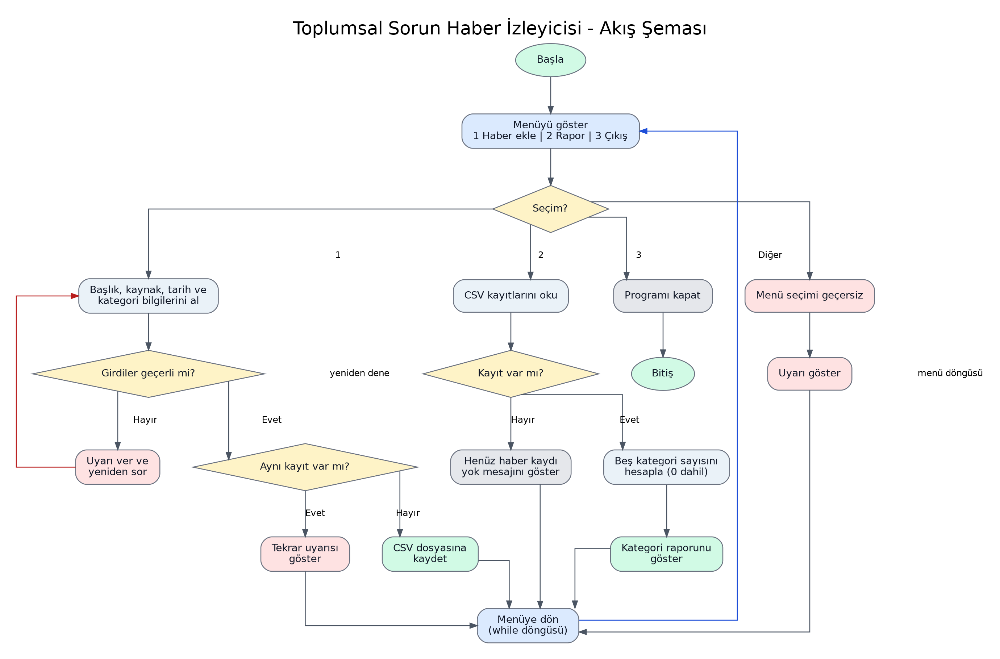
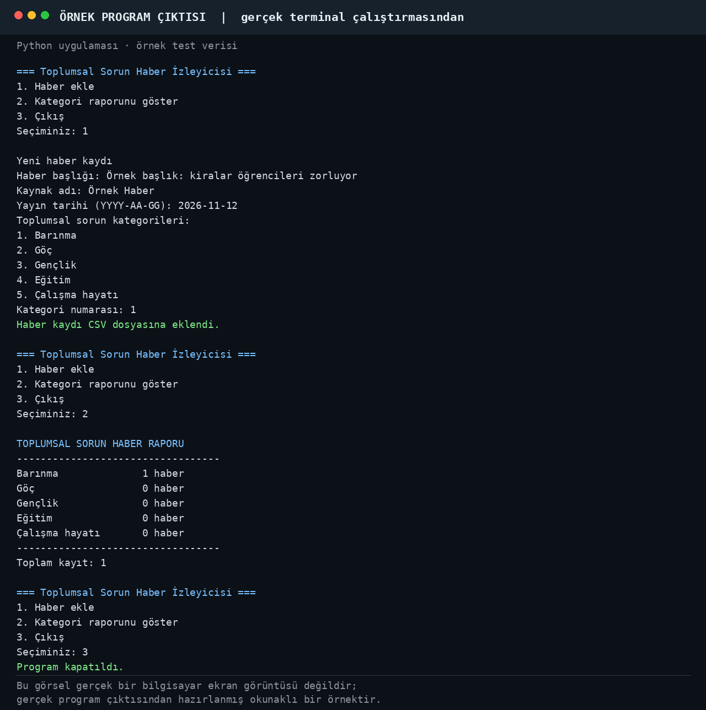

# Toplumsal Sorun Haber İzleyicisi

Bu, kamuya açık haber başlıklarını toplumsal sorun kategorilerine göre kaydeden ve her kategoride kaç haber bulunduğunu gösteren basit bir Python komut satırı uygulamasıdır. Sosyoloji öğrencileri, araştırmacılar veya bir sivil toplum ekibinin medya takibi yapan üyeleri için örnek bir araçtır. Haberleri internetten otomatik çekmez.

## Nasıl çalışır?

Uygulama her haber için şu bilgileri ister:

- Haber başlığı
- Kaynak adı
- Yayın tarihi (`YYYY-AA-GG` biçiminde)
- Kategori: Barınma, Göç, Gençlik, Eğitim veya Çalışma hayatı

Başlık ve kaynak boş bırakılamaz. Tarih geçerli bir takvim tarihi olmalıdır; gelecekteki geçerli tarihler de kabul edilir. Kategori, listeden numarasıyla seçilir. Program kişi iletişim veya kimlik bilgisi istemez; başlık alanına haber başlığı dışında özel bilgi girmeyin.

Menüde haber ekleme, kategori raporunu gösterme ve çıkış seçenekleri bulunur. Rapor, beş kategorinin tamamını gösterir; kayıt bulunmayan kategorilerin sayısı `0` olur. Henüz hiç haber yoksa “Henüz haber kaydı yok.” mesajı çıkar.

## Akış şeması

Şema; menüyü, girdi doğrulamasını, tekrar kayıt kontrolünü, CSV’ye yazmayı ve kategori raporunu gösterir.



Kayıtlar, program dosyasının yanındaki `haber_kayitlari.csv` dosyasında tutulur. Dosya ilk kayıt eklenirken sütun başlıklarıyla oluşturulur. Sonraki haberler yeni satırlara eklenir. Başlık ve kaynak karşılaştırılırken büyük/küçük harf farkı yok sayılır; aynı tarih ve kategoriyle tekrar girilen haber engellenir. Başlık veya kaynak içindeki birden fazla boşluk ise birleştirilmez ve farklı yazım olarak değerlendirilebilir.

Örnek CSV içeriği (kurgusal test verisi):

```csv
baslik,kaynak,yayin_tarihi,kategori
"Örnek başlık: kiralar öğrencileri zorluyor",Örnek Haber,2026-11-12,Barınma
```

## Çalıştırma

Bilgisayarında Python 3 kuruluysa proje klasörünü açıp terminalde şu komutu çalıştır:

```bash
python uygulama.py
```

Bazı macOS ve Linux sistemlerinde komut şu şekilde olabilir:

```bash
python3 uygulama.py
```

Uygulama yalnızca Python standart kütüphanesini kullanır; ek paket kurmak gerekmez.

## Gerçek çalıştırmadan örnek çıktı

Aşağıdaki PNG, uygulamanın gerçek bir Python çalıştırmasından alınan terminal çıktısından hazırlanmıştır. Gerçek bilgisayar ekran görüntüsü değildir. Başlık ve kaynak, örnek test verisidir; gerçek bir haber olarak sunulmamaktadır.



## Test senaryoları

Senaryolar Python ile çalıştırıldı. Beklenen ve gerçekleşen sonuçlar aşağıda ayrı gösterilmiştir.

| Girdi / senaryo | Beklenen sonuç | Gerçek sonuç |
|---|---|---|
| Geçerli başlık, kaynak, `2026-11-12` tarihi ve Barınma kategorisi | Kayıt CSV’ye eklenir ve yeniden okunabilir. | Başarılı; CSV başlığı ve veri satırı oluştu, kayıt doğru okundu. |
| Boş başlık, ardından geçerli başlık | Uyarı verilir; başlık yeniden istenir. | Başarılı; boş değer reddedildi ve geçerli başlık alındı. |
| Boş kaynak, ardından geçerli kaynak | Uyarı verilir; kaynak yeniden istenir. | Başarılı; boş değer reddedildi ve geçerli kaynak alındı. |
| `2026-02-30`, ardından `2026-11-12` | Takvimde olmayan tarih reddedilir; yeniden tarih istenir. | Başarılı; geçersiz tarih reddedildi, geçerli tarih kabul edildi. |
| Kategori numarası `9`, ardından `1` | Geçersiz seçim reddedilir; listedeki kategori yeniden istenir. | Başarılı; `9` reddedildi ve Barınma seçimi kabul edildi. |
| Aynı haberin başlık ve kaynak bilgileri Türkçe büyük harfle yeniden girilir | Yinelenen kayıt engellenir; ilk kayıt korunur. | Başarılı; tekrar eklenmedi ve CSV’de tek veri satırı kaldı. |
| Geçerli gelecek tarihi `2099-12-31` | Tarih kabul edilir. | Başarılı; tarih kabul edildi. |

Ek kontrollerde boş rapor mesajı, sıfır kayıtlı kategorilerin raporda görünmesi, hatalı menü seçiminden sonra menünün devam etmesi ve gerçek menü akışında kayıt-rapor-çıkış adımları denendi. Odaklı kontrollerde `13/13`, menü üzerinden uçtan uca kontrolde `1/1` sonuç başarılı oldu.
